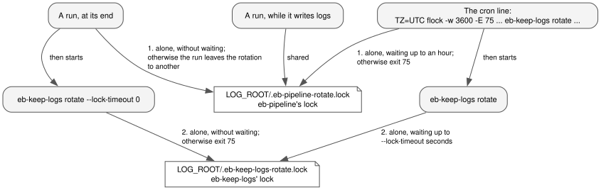

#+TITLE: Why the rotation takes two locks
#+OPTIONS: toc:nil todo:nil num:nil author:nil title:nil
#+STARTUP: content

* Why the rotation takes two locks

Why does a run rotate the log tree only when it can hold a lock alone, and why does every rotation take two locks, always in the same order?

** The problem

Each run writes its logs under =LOG_ROOT/LOG_STAMP/TARGET=, and the runs of every target of a site file, on every host, can share one log root.
=eb-keep-logs rotate= compresses the =*.log= and =*.txt= files of the run directories older than =--compress-after= days, deletes those older than =--delete-after= days, and rewrites the =.licensed-logs= file of each run it compresses: the list of the kept files closed to other users, as a failed compile line of licensed software can print the licence number.

A run's age counts from the midnight in Coordinated Universal Time (UTC) of its log stamp, so a run that started before midnight is a day old just after it, while it still writes.
Without anything to keep them apart:

- a rotation compresses the logs of a run that is still writing them, once that run is old enough;
- two rotations at once lose each other's changes to a run's =.licensed-logs=.

eb-keep-logs 0.2.1 takes no lock, and passes over at most the run that it writes into itself.

** How eb-pipeline handles it

Two =flock= locks in the log root keep the rotations apart from each other and from the runs that write into the tree.

#+CAPTION: Who takes the two locks in the log root, and in which order.
#+ATTR_RST: :alt A run holds eb-pipeline's lock, LOG_ROOT/.eb-pipeline-rotate.lock, shared while it writes logs. At its end it takes that lock alone without waiting, or leaves the rotation to another, and then starts eb-keep-logs rotate --lock-timeout 0, which takes eb-keep-logs' lock, LOG_ROOT/.eb-keep-logs-rotate.lock, alone without waiting, or exits 75. The cron line takes eb-pipeline's lock alone with flock, waiting up to an hour, or exits 75, then starts eb-keep-logs rotate, which takes eb-keep-logs' lock alone, waiting up to --lock-timeout seconds.

*** No rotation while a run is live

With =[logs.rotate]=, a run holds =LOG_ROOT/.eb-pipeline-rotate.lock= shared from its start, after =preflight=, to its end.
At its end it lets go of the lock, and takes it alone without waiting.
When it can, it rotates while it holds the lock; when it cannot, another run under the log root is live or rotating, the =logs= phase is =skipped=, and the rotation is left to a run that ends alone.
A run that starts while another rotates waits for it, so a rotation never runs beside a live run, and the last run to end alone rotates.

*** No two rotates at once

An eb-keep-logs whose =--help= lists =--lock-timeout= takes =LOG_ROOT/.eb-keep-logs-rotate.lock= alone in =rotate=, from before it lists the log root until it exits.
It waits for the lock up to =--lock-timeout= seconds, 600 unless given, and 0 does not wait; when the wait runs out, it exits 75, having changed nothing.
That lock keeps two rotates apart, but not a rotate and a run that still writes on another host, which is what eb-pipeline's lock is for.

*** One order

Whatever takes both locks takes eb-pipeline's first and eb-keep-logs' second.
A run's rotation does, and so does a rotation from cron through =flock(1)=, as in [[file:../howto/rotate-logs.org][Rotate the log tree]]; eb-keep-logs takes only its own.
So nothing waits for eb-pipeline's lock while it holds eb-keep-logs', and two rotations cannot deadlock.

*** A run does not wait for another rotate

=run= passes =--lock-timeout 0=.
While it rotates, a run holds eb-pipeline's lock alone, and every run under the log root that starts meanwhile waits for it, so a wait for another rotate would hold those runs back as well.
A =rotate= that exits 75 leaves =logs= =skipped=, with a note that names =.eb-keep-logs-rotate.lock=, and the rotation to the rotate that holds it.
That rotate lists the log root after it takes the lock, so it does this rotation's work, and a later run that ends alone does what is left.

*** Older eb-keep-logs

eb-keep-logs 0.2.1 refuses =--lock-timeout= with exit 2, and the builds that take it print the same version, so =run= passes the option only when =eb-keep-logs --help= lists it.
It reads the help where it checks =min_version=, with the environment of the rotation, and only when it rotates.
Without the option the rotation runs as it does with 0.2.1, and an =INFO= line and the note of =logs= say why, here from =docs/examples/rotation.sh= with a stand-in whose help leaves the option out:

#+begin_example
INFO [logs] cpu: no --lock-timeout for eb-keep-logs rotate: `eb-keep-logs --help` does not list it, as in eb-keep-logs 0.2.1, which takes no lock of its own
#+end_example

** What was considered and turned down

- /Waiting for another rotate inside a run./
  The run would hold eb-pipeline's lock alone while it waits, and so every run that starts on the log root meanwhile.
- /Taking eb-pipeline's lock in eb-keep-logs./
  A run starts =eb-keep-logs rotate= while it holds that lock alone, so eb-keep-logs would wait for the run that waits for it.
- /Choosing =--lock-timeout= by the version that eb-keep-logs prints./
  The builds that take the option print 0.2.1 as well, so only the help tells them apart.
- /Recording an exit 75 of =rotate= as a failure./
  Nothing changed, and the rotate that holds the lock does the work, so =logs= is =skipped= and the status of the run stays as it was.

** Limits

- The locks hold between nodes only where the filesystem of the log root carries =flock= between them.
- Only a run whose site file has =[logs.rotate]= takes eb-pipeline's lock, so a run of a site file without it that writes into the same log root is not kept apart from the rotations.
- A run can start while the cron line waits, so on a log root that always has a live run the cron line gives up after its hour, and the last run to end alone can rotate before it does.
- eb-keep-logs 0.2.1 takes no lock of its own; the cron line through =flock= keeps a rotation by it apart from the runs and their rotations.
- A run that cannot take its lock at all, as when its path is a directory in =docs/examples/rotation.sh=, logs a =WARN= and rotates without waiting for other runs:

  #+begin_example
  WARN [logs] cpu: cannot lock $WORK/other/.eb-pipeline-rotate.lock: Is a directory (os error 21); the rotation does not wait for other runs
  #+end_example

** Further reading

- [[file:../howto/rotate-logs.org][Rotate the log tree]], for the configuration, the cron line and the messages.
- [[file:../reference/log-tree.org][The log tree and its locks]], for the files and the locks.
- The [[https://stackhands.github.io/eb-keep-logs/][eb-keep-logs documentation]], for what =rotate= does to a run directory.
