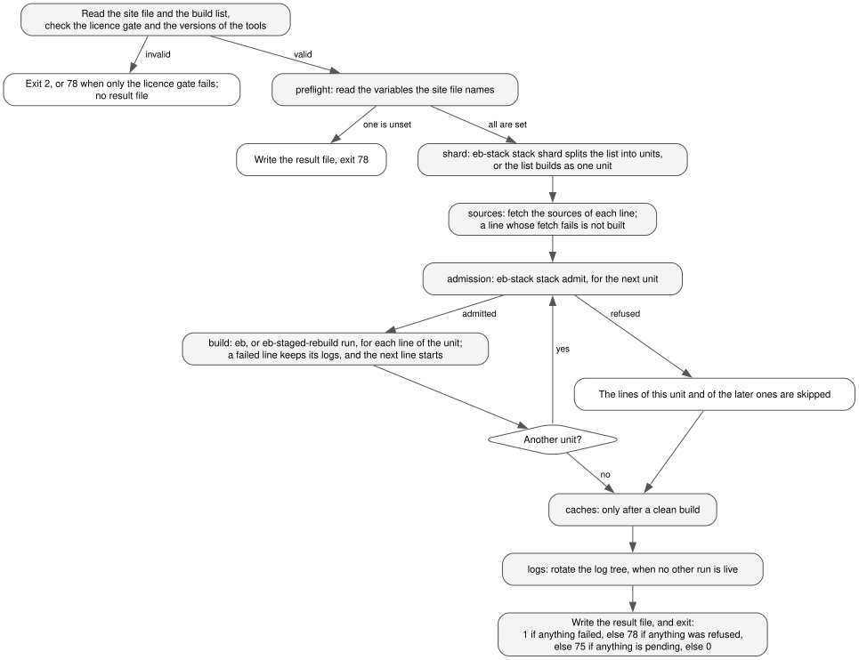

#+TITLE: How a run goes through its phases
#+OPTIONS: toc:nil todo:nil num:nil author:nil title:nil
#+STARTUP: content

* How a run goes through its phases

In what order does a run do its work, what stops it, and how does one exit status tell a caller what happened to a list of many lines?

** The problem

A run builds a list on one target through several tools, in many processes, and each tool has exit statuses of its own.
Some outcomes say that a build is broken, some that a precondition held the work back, some that a later rerun will do, and one run can end with all three.
The caller reads one exit status, and has to know from it what to do next, without reading the log of every line.

** How eb-pipeline handles it

*** The phases, in order

A run goes through =preflight=, =licences=, =shard=, =sources=, =admission=, =build=, =checks=, =caches= and =logs=, in that order.
A phase whose table is absent, or has =enabled = false=, is =not configured=, and the run passes over it.
With =[resume]= enabled, the shard phase is planned even when =[shards]= is not.

#+CAPTION: The phases of one run, and what each outcome does to the rest of it.
#+ATTR_RST: :alt The run reads the site file and the build list and checks the licence gate and the versions of the tools; when they are invalid it exits 2, or 78 when only the licence gate fails, with no result file. preflight reads the variables that the site file names; when one is unset, the run writes the result file and exits 78. shard splits the list into units, and sources fetches the sources of each line. Then each unit is admitted and its lines built, one unit after the other; a refused admission skips that unit and the later ones. caches runs only after a clean build, logs rotates the log tree when no other run is live, and the run writes the result file and exits 1 if anything failed, else 78 if anything was refused, else 75 if anything is pending, else 0.

Before the first phase, =run= reads the site file and the build list, and checks the licence gate and the versions of the tools.
An error there exits 2, or 78 when only the licence gate fails, and writes no result file, so the caller reads the exit status before the file.
The =licences= phase records the gate that passed.

- =preflight= reads the variables that the site file names, such as the one that =[admission]= =job_id_env= names; one that is unset, or a job id that is not a number, refuses the run, with exit 78.
- =shard= has =eb-stack stack order --hashes-out= record the input identity when =[resume]= is enabled, and =eb-stack stack shard= split the list into units, or builds the list as one unit when the planner exits with =shards.planner_exit_unsharded=.
  Any other failure ends the run before the first build, with exit 1, or 2 when =stack order= or =stack shard= exits 2.
- =sources= fetches the sources of each line; a line whose fetch fails is =failed= and is not built, and the other lines go on.
- =admission= and =build= take one unit at a time.
  A refusal after the last attempt skips the lines of that unit and of every later one, and the run exits 78, or 1 when a line failed before; any other failure of =stack admit= ends the run at once.
- =build= starts the lines of a unit in list order.
  A line that fails keeps its logs, with =eb-keep-logs failed= when =[logs]= =keep_failed= is set, and the next line starts; so does the next line after a staged line that eb-staged-rebuild refused or left pending.
- =checks= runs =[checks].command= once, after a clean build and before caches, on the short launch line.
  =when = "clean"=, the default, runs after every clean build.
  =when = "staged"= runs only when the list rebuilds an installed module; otherwise the phase is not configured, with the reason =no staged rebuild in this list=.
  A non-zero status fails the run and skips caches.
  A build that did not finish cleanly does not start the command.
  The swapped tree stays where the rebuild left it; =eb-staged-rebuild rollback= puts the previous generation back.
  A site points the command at the regression suite it already runs, for example =reframe -C /opt/site/reframe/config.py -c /opt/site/checks -r= with =when = "staged"=.
- =caches= runs only after a clean build, and =logs= rotates the log tree, as [[file:log-rotation.org][Why the rotation takes two locks]] describes.

*** Units, one at a time

=stack shard= splits a list into units: the CPU-only prerequisites, when it lifts them out, then the prelude, which holds the modules that two or more shards need, then each shard.
=run= builds them in that order, one at a time, each after an admission of its own.
Each admission reserves the inodes of one unit, and the reservation is removed when the builds of that unit end, so a run holds the quota for the unit it builds, not for the whole list.

*** One exit status for the whole run

A signal ends the run with its own status: =run= passes =SIGTERM= or =SIGINT= to the child that is running, starts no other, writes the result file, and exits 143 or 130.
Otherwise the run exits 1 when a line or a phase failed, else 78 when something was refused, by a precondition, by admission or by eb-staged-rebuild, else 75 when a step is pending, else 0.

The order puts first what needs the most from a person.
A failed build needs someone to read its log, whatever else happened in the run; a refusal needs a precondition met or the quota freed, and the lines built before it stay built; a pending step needs only a rerun.
The result file keeps what the status leaves out: the status of every line, with its log, and the counts.
The run summary keeps the same for every target that ran with the log stamp, and ranks their statuses in the same order, as [[file:../reference/run-summary.org][The run summary]] says.

*** The statuses of the tools, mapped

The same number means different things to different tools: 2 is a usage error for eb-pipeline, and a refusal for =eb-staged-rebuild run=.
So =run= reads the status of each tool as that tool defines it, and records what it means:

- =eb-stack stack admit= exits 0 when it admits, 78 when it refuses, which =run= retries with the backoff of =[admission]=, 1 when it fails and 2 on a usage error.
- =eb-stack stack shard= exits with =shards.planner_exit_unsharded= when it built the plan unsharded, and the run goes on with one unit.
- =eb-staged-rebuild run= exits 2 for a refusal, which the line records as =refused= with =translated_from = 2=, and 75 when a record that its ledger requires is pending.
- =eb-keep-logs rotate= exits 75 when another rotate holds its lock, and the =logs= phase is =skipped=, with the status of the run as it was.

Any other status but 0 of these commands is a failure.
=eb-keep-logs failed=, which keeps the logs of a failed line, only logs a =WARN= when it fails.

** What was considered and turned down

- /An exit status that counts the failures./
  An exit status is one byte, and a count would run into the statuses that mean something else, such as 2, 75 and 78; the result file has the counts.
- /Passing the status of a tool through as the status of the run./
  The caller would read eb-staged-rebuild's refusal, 2, as a usage error of eb-pipeline's.
- /Building one shard alone./
  A shard can need what the prelude installs, so =run= builds the units in order and has no option to build one of them.

** Limits

- A run builds one unit at a time; two units of a list never build at once in one run.
- A shard holds lines of the input list only, so a line whose other dependencies are not installed needs =--robot= to build them.
- A job that the scheduler kills leaves its reservation behind, and =stack admit= counts it, unless =[admission]= =live_jobs_cmd= lists the jobs that still run.
- A signal ends the run only after the running child has ended.

** Further reading

- [[file:../reference/exit-status.org][Exit status]], for the table of statuses.
- [[file:../reference/plan-and-result.org][The plan and result files]], for the statuses of the lines and the phases.
- [[file:design.org][Why one site file drives the build]], for why the commands come from the site file.
